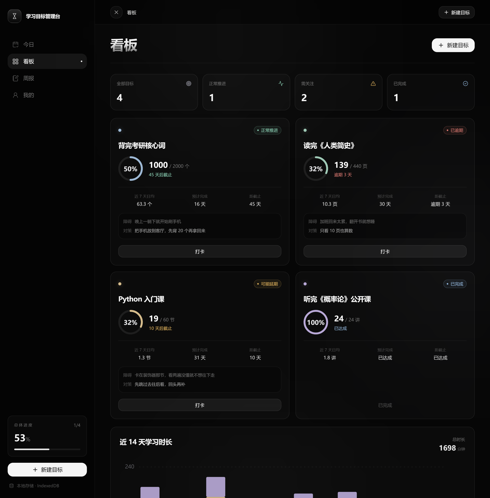
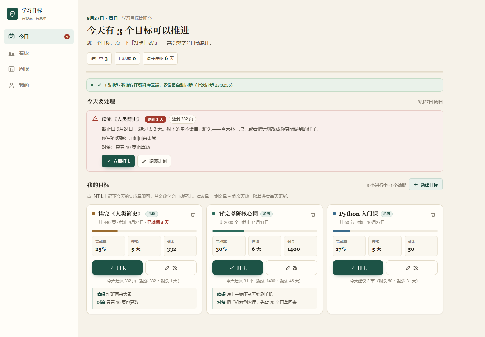

# 学习目标管理台 · Check-in Activity

[](https://github.com/2676136489-png/Check-in-activity/actions/workflows/ci.yml)
[](./LICENSE)


**在线演示**：<https://study-goal-console-59328.app.workbuddy.host/>（免登录）
**备用入口**：<https://2676136489-png.github.io/Check-in-activity/>（与主站同一份构建产物）

以打卡驱动目标推进的个人工作台，流程为：设定目标、每日打卡、按近 7 天日均速度估算剩余天数、每周复盘。

多数打卡工具统计连续天数，本工具回答的是「按当前速度，剩余工作量还需多少天」。算法、状态模型与交互均围绕这一目标设计。

仓库包含两套功能对齐的实现：单文件 HTML 版（零依赖，双击即可打开）与 React + TypeScript 工程化版（分层架构，数据源可替换）。在线演示部署的是工程化版。

首次打开为空态，数据默认存储在浏览器本地。点击「载入示例数据」可查看四组带 14 天记录的目标，覆盖推进中、可能延期、已逾期、已完成四种状态。

---

## 界面预览

工程化版 · 今日（截图为 Playwright 实拍）


工程化版 · 看板（环形进度、四态标签、手写 SVG 的 14 天堆叠柱状图）



移动端适配（320 / 360 / 390 / 834 / 1440 / 1920 六档视口，无横向溢出）


单文件版 · 今日（独立实现，零外链、零依赖，单文件 2338 行）



---

## 目录

- [技术栈](#技术栈)
- [架构](#架构)
- [关键设计决策](#关键设计决策)
- [工程实践](#工程实践)
- [目录结构](#目录结构)
- [快速开始](#快速开始)
- [部署](#部署)
- [已知限制](#已知限制)

---

## 技术栈

| 层 | 选型 | 说明 |
|---|---|---|
| 视图 | React 18 · TypeScript 5 · Tailwind CSS | 严格模式，未使用 `any` |
| 构建 | Vite 5 | `base: './'`，支持任意子路径部署 |
| 静态检查 | ESLint 9（flat config）· typescript-eslint | 启用 `react-hooks/rules-of-hooks` |
| 测试 | Vitest 2 | 领域层纯函数单测，80 个用例 / 5 个文件 |
| 渲染验证 | react-dom/server + Vite `ssrLoadModule` | 26 项断言，验证页面可正常渲染 |
| CI | GitHub Actions | 4 个 job：lint / 类型检查 / 单测 / 冒烟 / 构建、产物字节复现、页面交互冒烟、敏感信息扫描 |
| 存储 | Repository 模式 | IndexedDB（默认，零配置）/ Supabase，适配器可替换 |
| 图表 | 手写 SVG | 环形进度与 14 天堆叠柱状图均自行绘制 |

---

## 架构

工程化版采用依赖倒置，业务层不依赖具体存储实现：

```
┌────────────────────────────────────────────────┐
│                  UI (React)                    │
│      components/ · hooks/useStore.ts           │
└───────────────────┬────────────────────────────┘
                    │  领域类型 + 纯函数
┌───────────────────▼────────────────────────────┐
│            Domain（无副作用、可单测）             │
│   types/  · lib/date.ts  · lib/eta.ts        │
│           · lib/chart.ts  · lib/sample.ts    │
│      ← 80 个单测全部位于该层                     │
└───────────────────┬────────────────────────────┘
                    │  Repository 接口
┌───────────────────▼────────────────────────────┐
│           Data（可替换适配器）                    │
│   repo/types.ts ┌──────────┬──────────┐        │
│                 │IndexedDB │ Supabase │        │
│                 └──────────┴──────────┘        │
└────────────────────────────────────────────────┘
```

更换数据源只需修改 `createRepo()` 工厂函数，业务代码无需改动。

---

## 关键设计决策

### 1. 领域逻辑保持为纯函数

`lib/` 中的函数不操作 DOM、不访问存储、不读取系统时间。`buildGoalView(goal, logs, today)` 接收目标与打卡记录，输出包含 ETA 与状态的视图对象；`stackByGoal(goals, logs, today)` 将记录转换为堆叠柱的分段数据。

早期实现中，`recentDays(7)` 隐式读取真实日期，导致传入的 `today` 仅影响状态判定、不影响日均速度，函数无法进行确定性测试。引入测试后改为 `recentDays(7, today)`。图表组件 `Chart14d` 存在同类问题，已同步改为参数注入。

### 2. 数据不足时不输出估算值

- 目标未填写总量时显示「补齐总量后即可估算」，不返回 `0 天`
- 近 7 天无有效打卡时 `etaDays` 返回 `null`，界面显示「暂无法估算」
- 图表仅统计填写用时的记录，未填写的日期不计入统计
- 远端写入失败时显式报错并保留本地草稿，不进行静默降级

所有写操作先落地草稿再写远端，失败时提供明确出口。

### 3. 状态文案与状态一致

已完成但截止日已过的目标，若仍显示「逾期 10 天」，语义与实际不符。该规则固化为纯函数 `dueLabel(status, dueDays)`：`done` 状态统一显示「已达成」，其余状态按「逾期 N 天 / N 天后截止 / 今天截止」输出。已完成的目标不再显示预计完成天数。

### 4. 产物逐字节可复现

单文件版由 `build/` 下三个片段合成：

```bash
cd build && python merge.py      # p1.html + p2.html + final_script.js → ../学习目标管理台.html
```

合成结果与仓库中的 `学习目标管理台.html` 必须逐字节一致。此前出现过交付文件被手工修改、`build/` 未同步的情况，导致构建目录与实际运行产物不一致。该约束已写入 CI：`artifact-reproducible` job 重新合成并执行 `git diff --exit-code`，不一致即失败。

---

## 工程实践

### 静态检查 · `npm run lint`

ESLint 9 flat config，启用 `react-hooks/rules-of-hooks`。该规则曾拦截一次线上级问题：

`App.tsx` 中的 `if (!repo) return <初始化中/>` 原位于三个 `useState` 之前。首屏 `repo` 为 null 时仅执行 3 个 Hook；`createRepo()` 解析完成后同一轮执行 6 个 Hook，React 抛出 #310（*Rendered more hooks than during the previous render*），应用白屏，而 `tsc` 与 `vite build` 均无报错。该规则直接指出条件返回后的 Hook 调用问题。

### 单元测试 · `npm test`（80 个用例 / 5 个文件）

| 文件 | 用例 | 覆盖重点 |
|---|---|---|
| `eta.test.ts` | 14 | 休息日不计日均但计入累计；`avg7 = 0` 时 `etaDays` 返回 `null`；四态判定优先级；`dueLabel` 的已完成分支；周去重按周一 |
| `sample.test.ts` | 16 | 示例数据的确定性、日期落在 14 天窗口内、引用完整性、四种状态全覆盖 |
| `chart.test.ts` | 11 | 堆叠偏移连续、总量等于各段之和、缺目标不抬高 offset、未填用时的记录不计入 |
| `date.test.ts` | 10 | 闰年 `2028-02-28 → 02-29 → 03-01`、跨月跨年、周日归本周一、`recentDays` 含基准当天 |

测试过程中发现并修复两个问题：

1. Vitest 默认文件级并行，在部分沙箱环境中因 worker 写入模块缓存被拦截（`EPERM`），导致第二个测试文件被静默跳过但仍报告通过。已通过 `test.fileParallelism: false` 修复，原因记录于 `vitest.config.ts` 注释。
2. `build/shots.mjs` 与 `shots_data.mjs` 使用 `new URL(import.meta.url).pathname` 获取脚本目录，该值在中文路径下为 percent-encoded 形式，Windows 将其视为真实目录名。结果是页面读取走 `file://` URL（Chrome 自动解码），截图写入未解码路径，截图落在错误目录且与页面版本不一致。已改用 `fileURLToPath`。

### 渲染冒烟 · `npm run smoke`（26 项断言）

`tsc` 与 `vite build` 均不执行渲染。该脚本通过 `react-dom/server` 渲染 App、四个页签、空态与页头，断言内容正确：四态标签完整、图表柱按目标分色、已完成目标不误报逾期。

已知边界：SSR 不执行 `useEffect`，仅验证首屏渲染不抛错与内容正确；交互与 IndexedDB 持久化需在浏览器中确认。

### 单文件版验证

```bash
node build/smoke.mjs        # jsdom 构造桩数据运行页面，9 组交互断言（46 条 / 0 失败）
node build/shots.mjs        # Playwright 六档尺寸实拍与横向溢出扫描
```

### CI · [`.github/workflows/ci.yml`](./.github/workflows/ci.yml)

| Job | 内容 |
|---|---|
| `app` | `npm ci` → `lint` → `typecheck` → `test` → `smoke` → `build`（Node 20） |
| `artifact-reproducible` | 重新合成单文件版，`git diff --exit-code` 断言字节一致 |
| `single-file-smoke` | 单文件版 jsdom 交互冒烟 |
| `secret-scan` | 扫描 `sk-` / `ghp_` / `AKIA` / 私钥头等特征，命中即失败 |

`secret-scan` 的匹配模式拆分为数组后拼接，避免规则文本本身命中规则。

### 其他约定

- **敏感信息不入库**：密钥、令牌通过环境变量注入；`.gitignore` 覆盖 `.env*` / `*.key` / `*.pem` / `credentials.json`
- **LF 换行**：`.gitattributes` 全仓归一化，避免字节比对受 `core.autocrlf` 影响

---

## 目录结构

```
.
├── 学习目标管理台.html          # 单文件运行版（构建产物，2338 行 / 零外链）
├── app/                        # 工程化版（React 18 + TS + Vite，27 个源文件，约 2160 行）
│   ├── src/
│   │   ├── types/              # 领域类型
│   │   ├── lib/                # 纯函数与单测（date / eta / chart / sample / migrate / palette）
│   │   ├── repo/               # Repository 接口与 IndexedDB / Supabase 适配器
│   │   ├── hooks/              # useStore（集中状态）
│   │   └── components/         # UI（含 EmptyState 空态引导）
│   ├── scripts/smoke-render.mjs  # SSR 渲染冒烟
│   ├── public/favicon.svg      # 与设计系统同源的进度环图标
│   ├── eslint.config.js
│   └── vitest.config.ts        # fileParallelism: false（原因见注释）
├── 启动本地版.cmd               # Windows 一键启动：安装依赖、启动服务、打开浏览器
├── build/                      # 单文件版构建与验证工具链
│   ├── p1.html  p2.html        # 源片段：CSS / 骨架
│   ├── final_script.js         # 源片段：逻辑
│   ├── merge.py                # 合成 → ../学习目标管理台.html（逐字节可复现）
│   ├── smoke.mjs  shots.mjs    # 验证：交互断言 / 多尺寸实拍
│   └── seed.py                 # 示例数据种子（幂等，支持 --dry-run）
├── docs/                       # README 截图
├── .github/workflows/ci.yml    # CI（4 个 job）
├── 项目介绍.md                  # 设计取舍与背景
└── LICENSE                     # MIT
```

`build/` 中另有若干一次性排障脚本（`dbg*` / `fix_*` / `unmangle*`），不参与构建。`check.js` 与 `build_script.py` 属于 v1 遗留管线，已失效，不应执行（原因见 [`项目介绍.md`](./项目介绍.md)）。

---

## 快速开始

### 工程化版

Windows 下双击仓库根目录的 `启动本地版.cmd`：首次运行自动执行 `npm install`，随后在 <http://localhost:5173/> 启动服务并由 Vite 打开浏览器。关闭窗口即停止服务。

命令行等价写法：

```bash
cd app
npm install
npm run dev          # http://localhost:5173（自动打开浏览器：npm run dev -- --open）
npm run lint         # ESLint
npm test             # 80 个单测
npm run smoke        # 26 项渲染冒烟
npm run typecheck    # 类型检查
npm run build        # 产物在 app/dist/
npm run preview      # 预览构建产物：http://localhost:4173
```

数据存储在浏览器本地（IndexedDB，零配置、离线可用），按「浏览器 + 源」隔离。`localhost:5173` 与 `127.0.0.1:5173` 属于不同源，各存一份数据，建议固定使用 `localhost`。切换浏览器、清除站点数据或改用 `preview` 的 4173 端口时，将读取另一份数据。迁移数据前先在「我的」页面导出 JSON。

首次打开为空态。可通过以下方式载入数据：点击「载入示例数据」查看四组带 14 天记录的目标；新建目标；或在「我的」页面导入已有备份。

从已有数据迁移：「我的 → 导入 JSON」支持工程化版导出的备份与单文件版导出的备份（`{goals,logs,reviews}`，字段为 `blocker / counter / seed / sort`、`makeup`、`week`）。单文件版备份导入时自动完成字段映射，补全缺失的 `id` / `createdAt` / 截止日，无法解析的记录会明确提示跳过数量与原因。导入为整体替换（先清空再写入），文件中无目标时中止操作。

构建产物需通过 HTTP 服务访问。直接以 `file://` 打开 `app/dist/index.html` 时，浏览器会因 CORS 限制拒绝加载 ES module 与样式表，页面空白。使用 `npm run preview` 或任意静态服务。

### 单文件版

`学习目标管理台.html` 的数据通道由宿主页面注入（`window.__SMART_PAGE__.database`），仅在资料库页面中打开时具备读写能力。直接打开时走降级路径：界面正常渲染、空态有提示、不出现白屏，但新建目标不会持久化。

重新构建单文件版：

```bash
cd build && python merge.py
git diff --exit-code -- ../学习目标管理台.html   # 应无输出
```

---

## 部署

**当前线上**：<https://study-goal-console-59328.app.workbuddy.host/>

两个入口的更新方式不同：

| 入口 | 更新方式 |
|---|---|
| WorkBuddy 主站 | `cd app && npm run pub:sync` 重建 `web-dist/`，在 WorkBuddy 面板重新发布 |
| GitHub Pages | 推送至 `main`，workflow 自动构建 `app/dist` |

### 工程化版

```bash
cd app && npm run build
```

`dist/` 为纯静态产物，可部署至任意静态托管。已配置 `base: './'`，支持子路径部署。

### 同步至 WorkBuddy 发布目录

```bash
cd app && npm run pub:sync
```

该命令执行 `build` 后将 `dist/` 镜像至仓库根目录的 `web-dist/`，并校验 `index.html` 引用的资源均存在于产物中且无绝对路径，任一校验失败即非 0 退出。Windows 下也可双击根目录的 `同步线上产物.cmd`。WorkBuddy 发布目标为 `web-dist/`，仅执行 build 不会更新线上版本。

### GitHub Pages

`.github/workflows/pages.yml` 负责构建并发布 `app/dist`，站点 Source 设置为 **GitHub Actions**，推送至 `main` 即生效。地址：<https://2676136489-png.github.io/Check-in-activity/>。工作流包含一条断言：产物中不得出现 `src="/..."` 形式的绝对路径引用，否则失败，防止误改 `base` 导致白屏。

### Vercel

Framework 选择 Vite，Build Command 为 `npm run build`，Output Directory 为 `dist`，Root Directory 为 `app`。

### 单文件版

将 `学习目标管理台.html` 部署至任意静态托管即可。

---

## 已知限制

- **开发工具链存在 5 条中低危依赖公告**（`vite` / `esbuild` / `@vitest/mocker`）。生产依赖执行 `npm audit --omit=dev` 为 0 漏洞；上述问题仅影响本地开发服务器与测试环境。修复需升级 Vite 至 7+ / Vitest 至 5，属于破坏性升级，暂未处理。
- **测试覆盖集中在领域层**。组件层无单测，依赖 SSR 渲染冒烟与浏览器实测。扩展覆盖需引入 `@testing-library/react` 与 jsdom。
- **两个版本间仅通过导出 / 导入迁移数据**，非实时同步。实时打通需补充基于 `__SMART_PAGE__.database` 的适配器，而该通道仅在资料库宿主页面存在。字段映射已在 `lib/migrate.ts` 中实现，单文件版备份可直接导入。
- **`check.js` → `final_script.js` 上游构建已失效**（原因见 `项目介绍.md`）。需将 `check.js` 更新至 v2 或确认 `final_script.js` 为源。
- **`build/` 中保留若干排障脚本**，待归档至 `build/legacy/` 或清理。
- **GitHub Pages 演示页需手动启用**：工作流已就绪，需在仓库 Settings → Pages 中将 Source 设置为 GitHub Actions。

---

## 项目文档

- [`项目介绍.md`](./项目介绍.md) —— 项目背景、设计取舍与待办事项
- [`app/README.md`](./app/README.md) —— 工程化版架构、测试与 Supabase 接入步骤
- [`LICENSE`](./LICENSE) —— MIT
